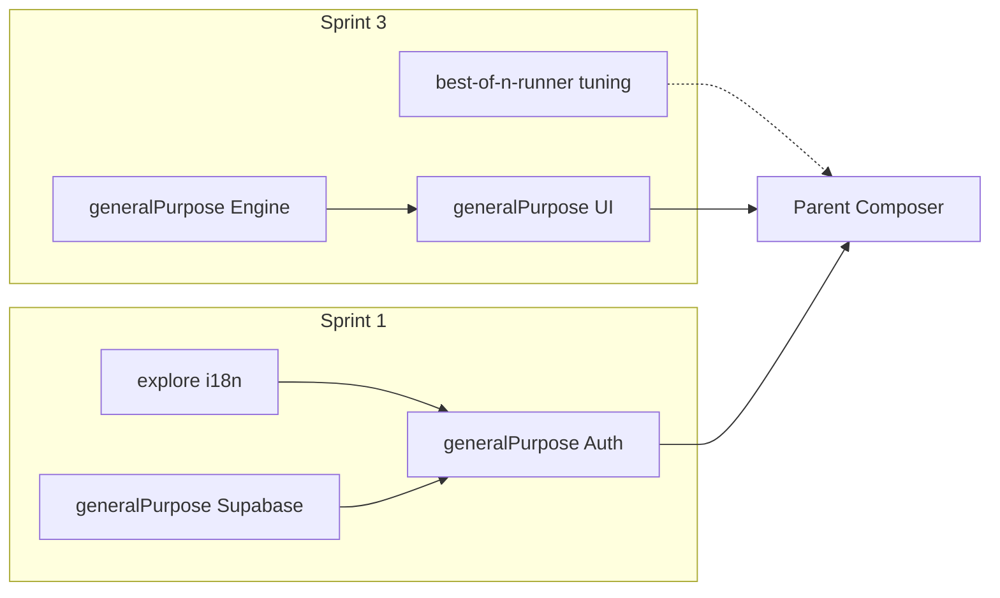

# Sprints Future Skills — agents à lancer

> Plan actualisé à partir de [`Matrice_exigences_FuturSkills.md`](./Matrice_exigences_FuturSkills.md).
>
> **Convention branche** : `cursor/<slug>-6b3e` · **Intégration** : agent parent (Composer) après chaque sous-agent.

---

## Vue d'ensemble

| Sprint | Objectif | Exigences clés | Durée indicative |
|--------|----------|----------------|------------------|
| **S0** | Alignement docx ↔ matrice | Réconciliation IDs | 0,5 j agent |
| **S1** | Fondation données & auth | FS-DATA-*, FS-AUTH-*, FS-ONB-*, FS-I18N-03 | 1 cycle |
| **S2** | Parcours & contenu réel | FS-MOD-*, FS-QUIZ-02, FS-PROG-01, FS-LIV-*, FS-FB-01, FS-DASH-* | 1 cycle |
| **S3** | Recommandations & plan dynamique | FS-RECO-01 → 05, FS-PLAN-02 | 1 cycle |
| **S4** | Magnification UX Niger | FS-ACC-*, FS-OFF-02, FS-MOD-04 | 1 cycle |
| **S5** | Certificat, mentorat, admin | FS-CERT-*, FS-MEN-*, FS-ADM-*, FS-RES-01 | 1 cycle |
| **S6** | Phase 2 | FS-RECO-06, FS-I18N-02, FS-ANA-01 | backlog |

---

## S0 — Réconciliation matrice (bloquant si docx disponible)

| # | Tâche | Agent | Mode | Prompt / livrable |
|---|-------|-------|------|-------------------|
| S0.1 | Importer `Matrice_exigences_FuturSkills.docx` → `docs/` | **Parent** | — | Utilisateur dépose le fichier ; agent convertit en MD et met à jour les colonnes Sprint/Statut. |
| S0.2 | Gap analysis docx vs code | **explore** | `readonly: true` | « Compare `docs/Matrice_exigences_FuturSkills.md` avec tout `src/`. Liste les IDs ABSENT/PARTIEL avec fichier preuve. » |

**Gate S1** : matrice validée (ou note explicite des écarts acceptés).

---

## S1 — Fondation Supabase & auth OTP

**Branche** : `cursor/supabase-auth-foundation-6b3e`

| # | Tâche | Agent | Parallèle | Prompt résumé |
|---|-------|-------|-----------|---------------|
| S1.1 | Schéma DB + migrations | **generalPurpose** | — | Lire skill Supabase. Créer tables : `profiles`, `cohorts`, `modules`, `lessons`, `user_lesson_progress`, `quiz_attempts`, `deliverables`, `feedback`, `mentoring_registrations`. RLS cohorte. |
| S1.2 | Auth OTP (email/tél) | **generalPurpose** | après S1.1 | Remplacer mock `Login.tsx` : envoi code, vérif session, redirect onboarding si nouveau. |
| S1.3 | Persister onboarding | **generalPurpose** | avec S1.2 | `Onboarding.tsx` → upsert profil (level, goal, city, whatsapp, cohort_code). |
| S1.4 | Audit i18n chaînes en dur | **explore** | oui (vs S1.1) | Lister tous les `lang === "fr"` et labels non traduits ; sortie checklist pour S1.5. |
| S1.5 | Fix i18n P1 | **generalPurpose** | après S1.4 | Clés `dashboard.*`, `navbar.plan10`, `videoPlayer.lite`, streak, certificat — FR/EN/HA. |

**Skills obligatoires** : `/skills/supabase/SKILL.md`, `/skills/supabase-postgres-best-practices/SKILL.md`

**Tests gate** : login OTP bout en bout · profil en base · switch FR/EN/HA sans texte FR résiduel sur Dashboard.

**Agent parent post-sprint** : merge, `npm run build`, PR `S1 — Fondation auth & données`.

---

## S2 — Parcours apprenant & règles de validation

**Branche** : `cursor/learner-progress-modules-6b3e`

| # | Tâche | Agent | Parallèle | Prompt résumé |
|---|-------|-------|-----------|---------------|
| S2.1 | API progression + déblocage modules | **generalPurpose** | — | Service `progressService` : % leçons, unlock M(n+1), seuils 80 % / 60 %. |
| S2.2 | ModuleDetail multi-modules | **generalPurpose** | après S2.1 | Charger leçons/quiz par `moduleId` (seed ou Supabase). Finir hardcode `lessonsM1`. |
| S2.3 | Seed contenu M2–M5 | **generalPurpose** | oui (vs S2.2) | Minimum : 3 leçons + 5 questions quiz par module (peut rester stub texte). |
| S2.4 | Livrables + feedback persistés | **generalPurpose** | après S2.1 | `Deliverables.tsx` / `Feedback.tsx` CRUD Supabase, statuts réels. |
| S2.5 | Dashboard données réelles | **generalPurpose** | après S2.1–S2.4 | Remplacer `currentUser` / `modules` mock par hooks query. |

**Gate** : M1 complété à 80 %/60 % débloque M2 · livrable soumis visible · dashboard reflète l'état réel.

**Agent parent** : intégration + tests manuels parcours J1→J2.

---

## S3 — Moteur de recommandations (cœur produit)

**Branche** : `cursor/recommendations-engine-6b3e`

| # | Tâche | Agent | Parallèle | Prompt résumé |
|---|-------|-------|-----------|---------------|
| S3.1 | Moteur règles pur | **generalPurpose** | — | `src/services/recommendationEngine.ts` : entrées profil/progression/quiz/livrables/jour ; sortie `Recommendation[]` priorisée ; tests Vitest (cas quiz raté, tout à jour, retard livrable). |
| S3.2 | UI Dashboard reco | **generalPurpose** | après S3.1 | `RecommendationCard`, section « Recommandé pour toi », lien « Pourquoi ? » i18n. |
| S3.3 | Plan 10j dynamique | **generalPurpose** | après S3.1 | `DayPlan.tsx` : fusion plan statique + reco du jour ; surligner tâche prioritaire. |
| S3.4 | Recos post-quiz / post-feedback | **generalPurpose** | après S3.1 | `Quiz.tsx` et `Feedback.tsx` : écran « Prochaine étape ». |
| S3.5 | Variante règles objectif emploi vs IA | **best-of-n-runner** | optionnel | 2 worktrees : tuning pondération `goal=employment` vs `goal=ai` ; parent choisit la meilleure via tests. |

**Règles v1 (rappel)** :

1. Feedback / livrable en retard  
2. Quiz &lt; 60 % → remediation leçon  
3. Leçon du jour non faite  
4. Objectif → M4/M3/M5 priorisé  
5. Mentorat &lt; 24 h  
6. Streak  
7. Fallback ressources  

**Gate** : 3 personas test (emploi, IA, débutant en échec quiz) → reco différente et CTA fonctionnel.

---

## S4 — UX magnification (contexte Niger)

**Branche** : `cursor/ux-lite-offline-a11y-6b3e`

| # | Tâche | Agent | Parallèle | Prompt résumé |
|---|-------|-------|-----------|---------------|
| S4.1 | Service Worker cache | **generalPurpose** | — | Cache HTML leçons + transcripts ; indicateur sync ; queue livrables offline. |
| S4.2 | WCAG pass | **explore** | oui | Audit aria/focus/contraste sur Dashboard, ModuleDetail, Quiz ; rapport priorisé. |
| S4.3 | Fixes a11y P1 | **generalPurpose** | après S4.2 | Corriger findings P0/P1 du rapport. |
| S4.4 | Navigation mobile apprenant | **generalPurpose** | oui (vs S4.1) | Bottom nav : Dashboard, Modules, Livrables, Plus (Plan, Mentorat, Ressources). |
| S4.5 | Vidéos production | **generalPurpose** | — | Remplacer `PLACEHOLDER` ; respect `isLite` (lien externe + transcription). |

**Gate** : Lighthouse a11y ≥ 90 sur Dashboard · mode avion : leçon texte lisible · navigation mobile 360px OK.

---

## S5 — Certificat, mentorat, admin

**Branche** : `cursor/certificate-mentoring-admin-6b3e`

| # | Tâche | Agent | Parallèle | Prompt résumé |
|---|-------|-------|-----------|---------------|
| S5.1 | Moteur éligibilité certificat | **generalPurpose** | — | `certificateService` : règles FAQ (5 mod, 80 %, 60 %, livrables, 1 mentorat). |
| S5.2 | UI certificat + PDF | **generalPurpose** | après S5.1 | Page/badge + export PDF simple (ou lien stockage). |
| S5.3 | Mentorat inscription réelle | **generalPurpose** | — | `mentoring_registrations` ; compteur places ; flag « a participé » pour certificat. |
| S5.4 | Admin exports & rappels | **generalPurpose** | après S5.1 | CSV réel, bouton rappel (email ou WhatsApp deep link). |
| S5.5 | Ressources liées aux recos | **generalPurpose** | après S3 | Filtrer `Resources.tsx` selon module faible + `recommendationEngine`. |

**Gate** : parcours complet mock → certificat débloqué · export CSV cohorte · inscription mentorat comptée.

---

## S6 — Backlog phase 2

| # | Tâche | Agent |
|---|-------|-------|
| S6.1 | Traduction Zarma | **generalPurpose** + relecture humaine |
| S6.2 | Reco admin manuelle | **generalPurpose** |
| S6.3 | Analytics entonnoir reco | **explore** puis **generalPurpose** |
| S6.4 | Scoring composite / micro-parcours IA | **best-of-n-runner** (expérimental) |

---

## Orchestration multi-agents (schéma)



### Règles d'orchestration

1. **Un agent = une branche** (`cursor/<slug>-6b3e`) sauf `explore` (readonly, pas de commit).
2. **Paralléliser** uniquement les tâches sans dépendance fichier (ex. S1.1 + S1.4, S4.1 + S4.4).
3. **best-of-n-runner** : réservé aux choix de design ambigus (pondération reco, pas le schéma DB).
4. **Parent** : merge, résolution conflits, `npm run build` + `npm test`, PR, mise à jour matrice Statut/Sprint.
5. **Ne pas lancer** `cursor-guide` ni `Notion` skills sauf gestion projet externe.

---

## Modèles d'invocation (copier-coller)

### Explore — gap matrice

```
subagent_type: explore
readonly: true
prompt: |
  Audite le repo Future Skills. Pour chaque ID dans docs/Matrice_exigences_FuturSkills.md,
  indique OK/PARTIEL/ABSENT avec chemin fichier. Priorise P0 ABSENT.
  Retourne un tableau markdown prêt à coller dans la matrice.
```

### GeneralPurpose — moteur recommandations (S3.1)

```
subagent_type: generalPurpose
prompt: |
  Branche: cursor/recommendations-engine-6b3e
  Implémente src/services/recommendationEngine.ts + tests Vitest.
  Règles: FS-RECO-01 à FS-RECO-04, seuils certificat FAQ (60% quiz, 80% leçons).
  Personnaliser par onboarding.goal. Pas de UI dans ce ticket.
  Commit + push. Rapporte les cas de test couverts.
```

### Best-of-n — tuning reco par objectif (S3.5)

```
subagent_type: best-of-n-runner
prompt: |
  Dans un worktree isolé, ajuste les poids du recommendationEngine pour
  goal=employment vs goal=ai. Documente 3 scénarios JSON entrée/sortie.
  Le parent choisira la variante avec tests verts.
```

---

## Checklist lancement sprint (agent parent)

- [ ] Branche `cursor/<slug>-6b3e` créée
- [ ] Matrice : colonne Sprint à jour
- [ ] Sous-agents lancés avec prompts ci-dessus (max 2–3 parallèles)
- [ ] Gates validés avant merge suivant
- [ ] PR draft par sprint avec lien exigences `FS-*`
- [ ] Matrice : statuts `OK` mis à jour post-merge

---

## Prochaine action immédiate

1. **Déposer** `Matrice_exigences_FuturSkills.docx` dans `docs/` → lancer **S0.2** (`explore`).
2. **Lancer en parallèle** **S1.1** (`generalPurpose` + skill Supabase) et **S1.4** (`explore` i18n).
3. Après merge S1 → enchaîner **S2** puis **S3** (recommandations).
